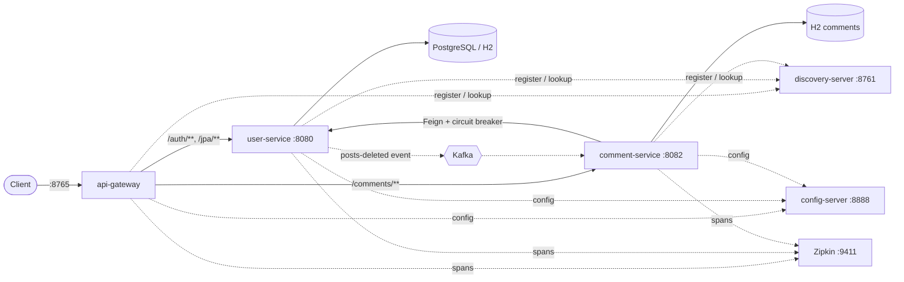

# Spring Boot Microservices — Interview Prep Project

[](https://github.com/GauravPawar-Git/Spring-boot-microservice/actions/workflows/ci.yml)

A REST API that grew, step by step, from a single Spring Boot app into a small microservice system: users, posts and comments, with JWT security, PostgreSQL, Docker, service discovery, an API gateway, circuit breakers, distributed tracing, metrics, caching and Kafka events.

It was built to learn and explain each concept, so the code is commented with the *why*, not just the *what*.

## Architecture



| Service | Port | Responsibility |
| --- | --- | --- |
| `user-service` (repo root) | 8080 | Users, posts, registration/login, issues JWTs |
| `comment-service` | 8082 | Comments on posts; own database; checks posts via user-service |
| `api-gateway` | 8765 | Single entry point; routes by path; load-balances via Eureka |
| `discovery-server` | 8761 | Eureka service registry |
| `config-server` | 8888 | Serves shared configuration from `config-repo/` |

## Tech stack

Java 25 · Spring Boot 4.1 · Spring Cloud 2025.1 · Spring Security (JWT, OAuth2 Resource Server) · Spring Data JPA / Hibernate · Flyway · PostgreSQL / H2 · OpenFeign · Resilience4j · Spring Cloud Gateway · Eureka · Config Server · Micrometer Tracing + Zipkin · Micrometer + Prometheus · Caffeine · Apache Kafka · Docker / Docker Compose · GitHub Actions · JUnit 5, Mockito, MockMvc, Embedded Kafka

## What's inside

| Area | Highlights |
| --- | --- |
| **Clean core** | Controller → Service → Repository, record DTOs, constructor injection, global exception handling, pagination & sorting |
| **Database** | `dev` (H2) and `prod` (PostgreSQL) profiles, Flyway migrations, `User 1—* Post`, N+1 demo vs `JOIN FETCH` / `@EntityGraph`, transactional rollback |
| **Security** | Stateless JWT (HS256), BCrypt passwords, `USER`/`ADMIN` roles, `@PreAuthorize` ownership checks, JSON 401/403, CORS |
| **Docker** | Multi-stage Dockerfile with Spring Boot layered jars, non-root user; Compose with PostgreSQL, health checks, `.env` secrets |
| **Microservices** | Eureka, Spring Cloud Gateway, OpenFeign, Resilience4j circuit breaker with fallbacks, database per service |
| **Production readiness** | CI pipeline, Config Server with live refresh, distributed tracing, Prometheus metrics, `@Cacheable`, Kafka events published after commit |

## Running locally

Prerequisites: **JDK 25**. Docker is optional (only for the Compose setup).

### Just the main service (H2, no other services needed)

```bash
./mvnw spring-boot:run
```

Open Swagger UI at http://localhost:8080/swagger-ui.html, call `POST /auth/login`, then click **Authorize** and paste the token.

Seed accounts (password `password123` for all): `rambo` (ADMIN), `shamlal`, `vigo`, `diga` (USER).

### The whole system

Build every project once:

```bash
./mvnw -q package -DskipTests
for p in config-server discovery-server comment-service api-gateway; do ./mvnw -q -f $p/pom.xml package -DskipTests; done
```

Then start each in its own terminal, **in this order**:

```bash
java -jar zipkin-server-3.6.1-exec.jar                            # optional, tracing UI on :9411
java -jar config-server/target/config-server-0.0.1-SNAPSHOT.jar
java -jar discovery-server/target/discovery-server-0.0.1-SNAPSHOT.jar
java -jar target/first-project-0.0.1-SNAPSHOT.jar                  # user-service
java -jar comment-service/target/comment-service-0.0.1-SNAPSHOT.jar
java -jar api-gateway/target/api-gateway-0.0.1-SNAPSHOT.jar
```

Zipkin's server jar is on [Maven Central](https://repo1.maven.org/maven2/io/zipkin/zipkin-server/3.6.1/zipkin-server-3.6.1-exec.jar). Wait about 30 seconds after the last service starts so Eureka's caches pick everything up, then send all requests to the gateway on port **8765**:

```bash
TOKEN=$(curl -s -H "Content-Type: application/json" \
  -d '{"username":"vigo","password":"password123"}' localhost:8765/auth/login \
  | sed 's/.*"accessToken":"\([^"]*\)".*/\1/')

curl -H "Authorization: Bearer $TOKEN" -H "Content-Type: application/json" \
  -d '{"postId":1,"text":"Great post!"}' localhost:8765/comments

curl "localhost:8765/comments?postId=1"
```

Kafka events are off by default (`EVENTS_ENABLED=false`). Set `EVENTS_ENABLED=true` and `KAFKA_SERVERS=host:port` on user-service and comment-service when a broker is available.

### Docker Compose (user-service + PostgreSQL)

```bash
cp .env.example .env        # set DB_PASSWORD and JWT_SECRET (head -c 32 /dev/urandom | base64)
docker compose up --build
```

## API overview

| Method & path | Access | Description |
| --- | --- | --- |
| `POST /auth/register` | Public | Create an account (role `USER`) |
| `POST /auth/login` | Public | Returns a JWT |
| `GET /auth/me` | Logged in | Current user |
| `GET /jpa/users?page=&size=&sort=` | Logged in | Paged list of users |
| `GET /jpa/users/{id}` | Logged in | One user |
| `POST /jpa/users` | ADMIN | Create a user without a login |
| `PUT /jpa/users/{id}` | ADMIN or self | Update a user |
| `DELETE /jpa/users/{id}` | ADMIN | Delete a user and their posts (publishes `posts-deleted`) |
| `GET /jpa/posts` | Public | Feed of all posts (one query, `JOIN FETCH`) |
| `GET /jpa/posts/{id}` | Public | One post (cached) |
| `GET /jpa/posts/n-plus-one` | Logged in | Same feed, built the N+1 way, for comparison |
| `GET /jpa/users/{id}/posts` | Public | A user's posts |
| `POST /jpa/users/{id}/posts` | ADMIN or self | Create a post |
| `POST /jpa/users/{id}/posts/bulk` | ADMIN or self | All-or-nothing bulk create (max 10 posts per user) |
| `GET /comments?postId=` | Public | Comments of a post, plus post details when user-service is reachable |
| `POST /comments` | Logged in | Add a comment (post must exist; banned words rejected) |
| `DELETE /comments/{id}` | Author or ADMIN | Delete a comment |

Useful extras: `/actuator/health`, `/actuator/prometheus` (user- and comment-service), `POST /actuator/refresh` on comment-service (ADMIN), the Eureka dashboard at http://localhost:8761, and `/actuator/gateway/routes` on the gateway.

## Tests

```bash
./mvnw verify                              # user-service
./mvnw -f comment-service/pom.xml verify   # comment-service
```

The tests cover:
- Service unit tests (Mockito).
- Web-layer slice tests with the real security rules (`@WebMvcTest`).
- JPA slice tests, including one that counts SQL statements to catch N+1 regressions (`@DataJpaTest`).
- Full-context tests: login flow, transaction rollback, caching, circuit breaker behaviour.
- Kafka publish and consume against an embedded broker.

CI runs all five projects on every push, then builds the Docker image and smoke-tests it with PostgreSQL ([workflow](.github/workflows/ci.yml)).

## Project layout

```
.                      user-service (Spring Boot app at the repo root)
├── comment-service/   comments, Feign client, circuit breaker, Kafka listener
├── api-gateway/       Spring Cloud Gateway routes
├── discovery-server/  Eureka server
├── config-server/     Spring Cloud Config Server
├── config-repo/       configuration served by config-server
├── Dockerfile, docker-compose.yml, .env.example
└── .github/workflows/ci.yml
```

## Notes

- The dev JWT secret in `application-dev.properties` is for local learning only. The `prod` profile requires `JWT_SECRET`, `DB_URL`, `DB_USERNAME` and `DB_PASSWORD` from the environment.
- Spring Cloud 2025.1.3 is built for Spring Boot 4.0.x. No release train for Boot 4.1 existed when this was written, and it was verified to run on 4.1.1.
