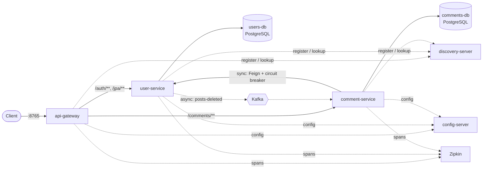

# Spring Boot Microservices: users, posts and comments

[](https://github.com/GauravPawar-Git/Spring-boot-microservice/actions/workflows/ci.yml)

A REST API that grew, step by step, from a single Spring Boot app into a microservice system running on Kubernetes: users, posts and comments, with JWT security, PostgreSQL, an API gateway, service discovery, a circuit breaker, Kafka events, distributed tracing, metrics and caching.

Every push is built and tested, started as 9 Docker containers, and deployed with Helm to a throwaway Kubernetes cluster, where the same end-to-end checks run.

🚀 **[Getting started](docs/GETTING-STARTED.md)**: start everything in order, then create and test data step by step (no Docker needed).
📖 **[Walkthrough](docs/WALKTHROUGH.md)**: what was built in each of the 8 phases, why, what went wrong, and the numbers measured.
🛠️ **[Runbook](docs/RUNBOOK.md)**: how to run it 4 ways, how to check every service, and troubleshooting.

## Architecture



| Service | Port | Responsibility |
| --- | --- | --- |
| `user-service` | 8080 | Users, posts, registration/login; issues JWTs; publishes `posts-deleted` events |
| `comment-service` | 8082 | Comments; its own database; checks posts via user-service; consumes `posts-deleted` |
| `api-gateway` | 8765 | Single entry point; routes by path; load-balances via Eureka |
| `discovery-server` | 8761 | Eureka service registry |
| `config-server` | 8888 | Serves shared configuration from `config-repo/`, live-reloadable |

## Highlights

| Area | What's inside |
| --- | --- |
| **Core** | Controller → Service → Repository, record DTOs, constructor injection, global error handling, pagination |
| **Data** | Flyway migrations, H2 (`dev`) / PostgreSQL (`prod`) profiles, N+1 demo vs `JOIN FETCH` (5 queries → 1, tested), transactional rollback, Caffeine cache with eviction |
| **Security** | Stateless JWT, BCrypt, `USER`/`ADMIN` roles, owner-only `@PreAuthorize`, JSON 401/403, OAuth2 Resource Server in comment-service |
| **Communication** | Sync: OpenFeign behind a Resilience4j circuit breaker with fallbacks. Async: Kafka event sent after commit (`@TransactionalEventListener`), idempotent consumer |
| **Platform** | Spring Cloud Gateway, Eureka, Config Server with `/actuator/refresh`, database per service |
| **Observability** | Micrometer Tracing + Zipkin (one trace across 3 services), Prometheus metrics with custom counters |
| **Containers** | One parameterized Dockerfile (layered jars, non-root UID, BuildKit cache), 9-container Compose with health checks |
| **Kubernetes** | Helm chart: probes on Spring Boot health groups, requests/limits, Secret, ConfigMap, StatefulSets, HPA, init containers |
| **Testing** | Unit, `@WebMvcTest`, `@DataJpaTest`, full-context, Embedded Kafka, **Testcontainers** (PostgreSQL 17 + Kafka 4.3.1), end-to-end script |
| **CI** | GitHub Actions: 5-project test matrix → Compose end-to-end → kind + Helm end-to-end + rolling-restart test |

## Tech stack

Java 25 · Spring Boot 4.1 · Spring Cloud 2025.1 · Spring Security · Spring Data JPA / Hibernate · Flyway · PostgreSQL 17 / H2 · OpenFeign · Resilience4j · Spring Cloud Gateway · Eureka · Config Server · Apache Kafka 4.3 (KRaft) · Micrometer Tracing + Zipkin · Micrometer + Prometheus · Caffeine · Docker · Docker Compose · Kubernetes · Helm · GitHub Actions · JUnit 5 · Mockito · Testcontainers

## Quick start

Four ways to run it; full steps and checks are in the **[Runbook](docs/RUNBOOK.md)**.

| Option | Needs | Command | You get |
| --- | --- | --- | --- |
| A. One service | JDK 25 | `./mvnw -pl user-service spring-boot:run` | user-service on H2, Swagger at http://localhost:8080/swagger-ui.html |
| B. All services as jars | JDK 25 | `./mvnw -q package -DskipTests` → `./scripts/start-local.sh` → `./scripts/seed-data.sh` / `./scripts/demo.sh` ([guide](docs/GETTING-STARTED.md)) | everything except Kafka |
| C. Docker Compose | Docker | `cp .env.example .env` → `docker compose up -d --build --wait` → `./scripts/e2e.sh` | all 9 containers, Kafka on |
| D. Kubernetes | Docker, kind, Helm | build images → `kind create cluster` → `helm upgrade --install ...` ([steps](docs/RUNBOOK.md#option-d--kubernetes-with-helm)) | the same system on Kubernetes |

Seed accounts (password `password123`): `rambo` (ADMIN), `shamlal`, `vigo`, `diga` (USER). Entry point: **http://localhost:8765**.

```bash
TOKEN=$(curl -s -H 'Content-Type: application/json' \
  -d '{"username":"vigo","password":"password123"}' localhost:8765/auth/login | jq -r .accessToken)
curl -H "Authorization: Bearer $TOKEN" -H 'Content-Type: application/json' \
  -d '{"postId":1,"text":"Great post!"}' localhost:8765/comments
curl "localhost:8765/comments?postId=1"
```

## Measured results

From the CI runs (GitHub Actions) and local runs. Details are in the [walkthrough](docs/WALKTHROUGH.md).

| What | Result |
| --- | --- |
| N+1 feed vs `JOIN FETCH` | 5 SQL statements → 1 |
| Circuit breaker with user-service down | comment writes: first 1.03 s (timeout), then 13–29 ms fast-fail; reads keep working. Gateway: 503 fallback, ~1 s for 3 calls, then 5–8 ms |
| Kafka clean-up across services | comments removed within 3–4 s of deleting the user |
| One request traced | api-gateway → comment-service → user-service in a single Zipkin trace |
| Full stack memory (Compose) | about 2.3 GiB for 9 containers |
| `helm install --wait` on kind | ready in 33–45 s; HPA scaled comment-service to 2 pods under start-up load |
| Rolling restart of user-service under traffic | 139 ok / 32 failed: Eureka's cached registry, a documented reason to prefer Kubernetes-native discovery |

## API overview

| Method & path | Access | Description |
| --- | --- | --- |
| `POST /auth/register` | Public | Create an account (role `USER`) |
| `POST /auth/login` | Public | Returns a JWT |
| `GET /auth/me` | Logged in | Current user |
| `GET /jpa/users?page=&size=&sort=` | Logged in | Paged list of users |
| `GET /jpa/users/{id}` | Logged in | One user |
| `POST /jpa/users` | ADMIN | Create a user without a login |
| `PUT /jpa/users/{id}` | ADMIN or self | Update a user |
| `DELETE /jpa/users/{id}` | ADMIN | Delete a user and their posts (publishes `posts-deleted`) |
| `GET /jpa/posts` | Public | Feed of all posts (one query, `JOIN FETCH`) |
| `GET /jpa/posts/{id}` | Public | One post (cached) |
| `GET /jpa/posts/n-plus-one` | Logged in | Same feed built the N+1 way, for comparison |
| `GET /jpa/users/{id}/posts` | Public | A user's posts |
| `POST /jpa/users/{id}/posts` | ADMIN or self | Create a post |
| `POST /jpa/users/{id}/posts/bulk` | ADMIN or self | All-or-nothing bulk create (max 10 posts per user) |
| `GET /comments?postId=` | Public | Comments of a post, plus post details when user-service is reachable |
| `POST /comments` | Logged in | Add a comment (post must exist; banned words rejected) |
| `DELETE /comments/{id}` | Author or ADMIN | Delete a comment |

Operational endpoints: `/actuator/health` (+ `/liveness`, `/readiness`), `/actuator/prometheus`, `POST /actuator/refresh` (comment-service, ADMIN), `/actuator/gateway/routes`, Eureka dashboard on :8761, Zipkin on :9411.

## Tests

```bash
./mvnw verify                              # all 5 modules: 56 tests (the Testcontainers one is skipped without Docker)
./mvnw -pl comment-service verify          # one module only
./scripts/e2e.sh                           # against a running Compose or Kubernetes stack
```

## Project layout

```
.                       parent pom.xml: the 5 modules below, shared versions and test settings
├── user-service/       users, posts, login/JWT, posts-deleted publisher, cache
├── comment-service/    comments, Feign client, circuit breaker, Kafka listener
├── api-gateway/        Spring Cloud Gateway routes
├── discovery-server/   Eureka server
├── config-server/      Spring Cloud Config Server
├── config-repo/        configuration served by config-server
├── helm/microservices/ Helm chart for Kubernetes
├── scripts/            start-local.sh / stop-local.sh, seed-data.sh (sample data), demo.sh (feature checks), e2e.sh (CI checks)
├── docs/               GETTING-STARTED.md, api-requests.http (sample bodies), WALKTHROUGH.md, RUNBOOK.md
├── Dockerfile          one image recipe for all five services
├── docker-compose.yml  the 9-container stack
└── .github/workflows/ci.yml
```

## Notes

- The dev JWT secret in `application-dev.properties` is for local learning only. Every other setup takes `JWT_SECRET` and database passwords from the environment or a Kubernetes Secret.
- Spring Cloud 2025.1.3 is built for Spring Boot 4.0.x. No release train for Boot 4.1 existed when this was written; it was verified to run on 4.1.1.
- Not done yet (next steps): Keycloak/RS256, transactional outbox, Grafana dashboards, quality and security scanning, load testing, Kubernetes-native discovery. See the end of the walkthrough.
